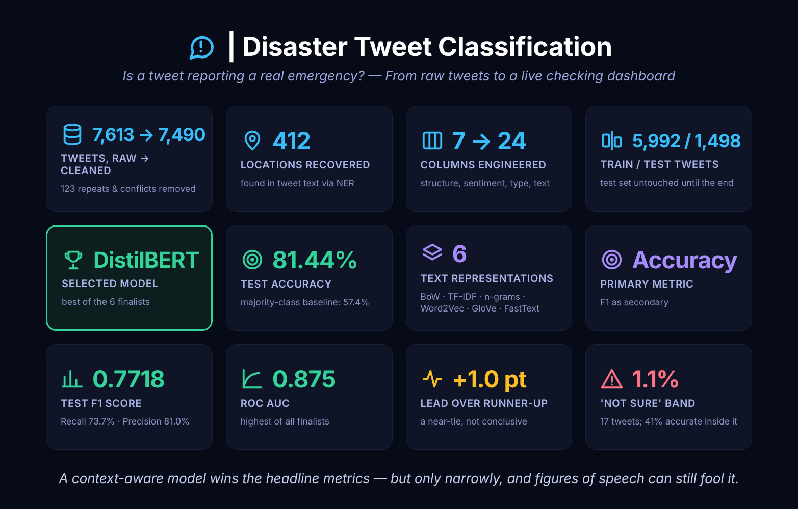

# 🚨 DISASTER TWEET CLASSIFICATION
### *Telling Real Emergency Reports from Everyday Language — From Raw Tweets to a Live Checking Dashboard*


---

### **From Raw Tweets to a Live Checking Dashboard**

During floods, fires and earthquakes, people post about them within minutes — but many posts use dramatic words in everyday ways ("this song is fire"). This project builds and compares six text classifiers that decide whether a tweet reports a real disaster, selects the best one on a strict, test-set-untouched protocol, and serves it through a plain-language Streamlit dashboard that a non-technical user can try in seconds.

Rather than building one model and reporting its score, the project builds six genuinely different approaches — classical models on sparse text features, models on word embeddings, a BiLSTM and a fine-tuned DistilBERT — and compares them on the same held-out tweets, then checks how far the winner can be trusted.

---

<p align="center">
  
</p>
<p align="center"><i>The project in twelve numbers — data, method, results and how far to trust them.</i></p>

---

> **⚠️ EVALUATION NOTICE:**
> Full findings, interpretations and model comparisons are in the notebook itself — every analytical
> section closes with an Interpretation block, and the notebook ends with a Final Model Comparison and
> Final Summary. A supplementary slide deck
> ([`Tweets_Classification_Presentation_YS.pptx`](./Tweets_Classification_Presentation_YS.pptx))
> covering the key results and the live dashboard is also included in this repository.

---

## 🔴 Live Dashboard

**[Disaster Tweet Checker](https://disaster-tweet-checker.streamlit.app/)**

Paste or type a short English message (or tap one of three examples) and the dashboard answers **Disaster report**, **Not a disaster** or **Not sure**, with a likelihood bar and a plain-language explanation.

> **Note:** the DistilBERT weights are downloaded from Hugging Face on first launch ([`ysakkaf/nhis-project7-distilbert`](https://huggingface.co/ysakkaf/nhis-project7-distilbert)). The first check after the app wakes from idle can take a minute; every check after that is quick.

---

## 📌 Project Overview

Emergency teams and news desks cannot read every post, and keyword searches fail because the same words ("fire", "flood", "armageddon") appear in jokes, songs and everyday exaggeration. The question this project answers:

> **Can a model tell a genuine disaster report from everyday use of the same words — and does a modern language model beat a simple, well-tuned baseline by enough to matter?**

---

## 🎯 Project Objectives

- Clean and audit the tweet data thoroughly — duplicates judged on content, conflicting labels resolved, missing locations recovered with named-entity recognition.
- Engineer new features from the raw text (structure, sentiment, disaster type, cleaned text) and explore them with full univariate, bivariate and multivariate analysis.
- Build and compare six text representations (Bag of Words, TF-IDF, TF-IDF with n-grams, Word2Vec, GloVe, FastText) plus YAKE keyword extraction.
- Train several model families — classical, embedding-based, BiLSTM and DistilBERT — and select finalists using training data only.
- Evaluate the six finalists once on a held-out test set, then validate the winner: selection-vs-test gap, loss curves, bootstrap confidence intervals and robustness to noisy text.
- Check deployment readiness (the "Not sure" band and a figurative-language stress test) and serve the winner through a Streamlit dashboard.

---

## ❓ Key Questions Answered

1. Which signals separate real disaster tweets from the rest — keywords, sentiment, links, wording?
2. Which text representation works best for which model family?
3. Does DistilBERT beat a simple Logistic Regression on TF-IDF — and by how much?
4. Is the winner's lead statistically clear, or a near-tie?
5. How does the selected model behave on noisy text and on figures of speech?
6. When should the dashboard say "Not sure" instead of forcing an answer?

---

## 🚀 Project Pipeline at a Glance

| Component | Environment | Purpose | Key Output |
|---|---|---|---|
| **disaster_tweet_classification.ipynb** | Google Colab (CPU) | Cleaning, feature engineering, EDA, representations, six model tiers, evaluation, validation, deployment checks | Saved model artifacts, `final_evaluation_bundle_*.pkl`, `test_predictions_*.pkl` |
| **prerequisites.py** | Shared module | Logging, display helpers, colour theme, Local → Drive → GitHub loading and saving | — |
| **disaster_tweet_dashboard.py** | Local (VS Code) | Live checking dashboard | Deployed Streamlit app |

The whole project is a **single notebook** that runs top to bottom in Google Colab.

---

## 📂 Dataset Overview

| Property | Detail |
|---|---|
| **Source file** | Tweets with columns `id`, `keyword`, `location`, `text`, `target` |
| **Raw tweets** | 7,613 |
| **After cleaning** | 7,490 (123 duplicates / conflicting repeats removed, 1.6%) |
| **Class balance** | 4,299 Non-Disaster (57.40%) / 3,191 Disaster (42.60%) |
| **Train / Test** | 5,992 / 1,498 (stratified 80/20, random state 42) |
| **Missing data** | `location` ~33% missing, `keyword` 56 rows |

---

## 🧹 Data Cleaning & Feature Engineering

- **Duplicates judged on content, not `id`** — `id` is unique per row, so an all-column check can never find anything. On the real text: 52 exact duplicates, 18 texts with conflicting labels (ties dropped, clear majorities kept) and 45 further repeats were removed.
- **Locations recovered with NER** — 412 real place names were found in the tweet text, with a noise guard rejecting long, URL- or handle-like spans; 2,064 remain genuinely unknown and are labelled `unknown` rather than guessed. A `location_source` column records which is which.
- **Features computed from the raw text** (character and word counts, hashtags, mentions, URLs, uppercase ratio, VADER sentiment, a rule-based `disaster_type`), because the later text cleaning removes capitals, links and hashtags. The dataset grows from 7 to 24 columns.
- **Outliers** in four numeric features were capped at the 99th percentile (277 values in total) — a choice that applies only to the numeric features used by the classical models, not to DistilBERT's text input.

---

## 📊 Exploratory Analysis — Key Findings

- A trivial "always predict Non-Disaster" model already scores **57.4%**, so every real model has to clear that bar.
- **Links are the clearest structural signal:** 67.3% of disaster tweets contain a URL against 41.7% of non-disaster tweets. Mentions run the other way (31.1% vs 20.7%).
- **Sentiment leans negative but is not decisive:** disaster tweets average −0.267 compound sentiment against −0.052, yet a negative tweet is not necessarily a real report.
- **Keywords alone mislead:** `outbreak` appears in 38 disaster tweets and 1 non-disaster tweet, while `body bags` appears in 40 non-disaster tweets and 1 disaster tweet. Words like `armageddon` and `deluge` are mostly used casually.
- No single numeric feature correlates strongly with the target (the strongest, sentiment compound, is only −0.229) — the reason the project needs real language models, not a handful of scalar features.

---

## 🧠 Models Built

| Tier | Representation | Finalist chosen by 5-fold CV / validation |
|---|---|---|
| Classical baselines | TF-IDF | **Logistic Regression** |
| Dense embeddings | Word2Vec / GloVe / FastText | **GloVe + LightGBM** |
| Feature-enhanced | TF-IDF + engineered features | **TF-IDF + Logistic Regression** |
| YAKE-enhanced | TF-IDF + keyword features | **TF-IDF + YAKE + Logistic Regression** |
| Neural sequence | Learned embeddings | **BiLSTM** |
| Contextual transformer | Subword tokens | **DistilBERT** (fine-tuned) |

Accuracy is the primary metric and F1 the secondary one; model selection inside a tier uses cross-validation on the training data only.

---

## 🏆 Results

| Rank | Finalist | Test Accuracy | Test F1 | Precision | Recall | ROC AUC |
|---|---|---|---|---|---|---|
| 1 | **DistilBERT** | **0.8144** | **0.7718** | 0.8103 | 0.7367 | 0.8749 |
| 2 | Logistic Regression | 0.8044 | 0.7468 | 0.8324 | 0.6771 | 0.8618 |
| 3 | TF-IDF + Logistic Regression | 0.8044 | 0.7468 | 0.8324 | 0.6771 | 0.8618 |
| 4 | TF-IDF + YAKE + Logistic Regression | 0.7997 | 0.7458 | 0.8118 | 0.6897 | 0.8568 |
| 5 | BiLSTM | 0.7917 | 0.7209 | 0.8396 | 0.6317 | 0.8525 |
| 6 | GloVe + LightGBM | 0.7897 | 0.7355 | 0.7920 | 0.6865 | 0.8535 |

**DistilBERT is selected** — highest Accuracy, F1, Recall, ROC AUC and Average Precision. It catches 470 of the 638 disaster tweets in the test set, 38 more than Logistic Regression, at the cost of 23 more false alarms.

**It is a close result, and the project says so.** The Accuracy lead over Logistic Regression is +0.0100 (about 15 of 1,498 tweets); its bootstrap 95% interval is [−0.0053, +0.0260] and includes zero. DistilBERT is declared the winner on the pre-agreed rule (highest test Accuracy, then F1), with Logistic Regression a simple, lightweight alternative.

---

## ✅ Validation & Deployment Readiness

- **Selection vs. test:** every finalist's test Accuracy is within 0.01 of its selection score — no sign that selection overfitted.
- **Overfitting:** both deep models overfit if trained past epoch 2; the best checkpoint is kept for each.
- **Confidence interval:** DistilBERT's test Accuracy is 0.8144 with a 95% interval of [0.7937, 0.8344].
- **Robustness:** with 20% of words dropped or misspelt, Accuracy falls by at most 0.014.
- **"Not sure" band:** only 17 of 1,498 test tweets (1.1%) score between 45% and 55%; Accuracy there is 0.4118 against 0.8190 outside it, so the dashboard shows "Not sure" instead of a forced answer.
- **Known limitation — figures of speech:** a short stress test showed that disaster words used figuratively can still be read as real emergencies, because in the training tweets words such as "fire" and "flood" mostly appear in real reports. A second DistilBERT trained on lightly cleaned original text scored similarly and did not remove the weakness, so it is documented but not adopted.

---

## 🖥️ The Dashboard

A Streamlit app serving the selected DistilBERT model.

- **Three example messages** (Disaster, Not a disaster, Not sure) and a free-text box for any English message up to 280 characters.
- **A plain-language answer** — *Disaster report*, *Not a disaster* or *Not sure* — with a likelihood bar and the model's percentage.
- **"What did the AI actually read?"** shows the cleaned text the model received.
- **"How it works"** summarises the held-out test results and compares all six models.
- A sidebar explains the project, how to use it, what the answers mean and how reliable it is (about 81 correct answers in 100), including the limitation on figures of speech.

---

## 🗂️ Repository Structure

```text
NHIS_Project7/
│
├── Assets/                                   # Data, saved models and results
│   ├── twitter_disaster.csv                  # Source tweets
│   └── models/                               # Saved artifacts (.pkl bundles, test predictions, model folders)
│
├── deploy_assets/                            # Dashboard runtime files (logo, evaluation bundle)
│
├── logs/                                     # Run logs written by the notebook
│
├── readme_assets/
│   └── hero_image.png                        # README hero image
│
├── .streamlit/config.toml                    # Dashboard theme configuration
│
├── disaster_tweet_classification.ipynb       # The full analysis (single notebook)
├── Tweets_Classification_Presentation_YS.pptx  # Slide deck
├── prerequisites.py                          # Shared utility module
├── disaster_tweet_dashboard.py               # Streamlit dashboard
│
├── requirements.txt                          # Slim — dashboard deployment only
├── requirements-full.txt                     # Complete — notebook and local development
├── LICENSE
└── README.md
```

> The fine-tuned DistilBERT weights (~268 MB) are hosted on Hugging Face: [`ysakkaf/nhis-project7-distilbert`](https://huggingface.co/ysakkaf/nhis-project7-distilbert). A second, lightly cleaned-text trial model is at `ysakkaf/nhis-project7-distilbert-raw` (not adopted).

---

## 📦 Library Architecture

| Library | Purpose |
|---|---|
| **pandas / numpy / scipy** | Data handling and numerical computing |
| **matplotlib / seaborn** | Visualisation |
| **scikit-learn** | Splitting, cross-validation, classical models, metrics |
| **nltk / spaCy** | Tokenisation, stop words, lemmatisation, named-entity recognition |
| **vaderSentiment** | Sentiment scores |
| **gensim** | Word2Vec, GloVe loading, FastText |
| **yake** | Keyword extraction |
| **lightgbm** | Gradient boosting on dense embeddings |
| **tensorflow / keras** | BiLSTM |
| **torch / transformers / accelerate** | DistilBERT fine-tuning and inference |
| **streamlit** | The dashboard |
| **joblib** | Saving and loading trained models and results |
| **huggingface_hub** | Hosting and downloading the DistilBERT weights |
| **gdown** | Downloading saved files from Google Drive (fallback in the loading cascade) |

Exact pinned versions are in `requirements-full.txt` (everything needed for the notebook and local development) and `requirements.txt` (the slimmer set needed only to run the dashboard, with CPU-only PyTorch).

> The notebook also downloads the NLTK word lists and the spaCy English model (`en_core_web_sm`) on its first run, so no manual download step is needed.

---

## 💻 Installation & Setup

### Step 1 — Run the notebook (Google Colab)

1. Upload `disaster_tweet_classification.ipynb` to Google Colab.
2. `prerequisites.py` downloads itself from GitHub if not present.
3. Data and saved models load through a **Local → Google Drive → GitHub** cascade — no manual setup is needed when running against this repository. The DistilBERT weights load from Google Drive or Hugging Face.
4. Run top to bottom. Saved artifacts are reused on later runs, so a rerun skips the long training steps (a full DistilBERT retrain takes over an hour on CPU).

### Step 2 — Run the dashboard (local)

The dashboard cannot run in Colab.

```bash
git clone https://github.com/S-Yousuf-S/NHIS_Project7.git
cd NHIS_Project7
python -m venv NLP_ENV
```

**Windows:** `NLP_ENV\Scripts\activate`
**macOS / Linux:** `source NLP_ENV/bin/activate`

```bash
pip install -r requirements.txt
streamlit run disaster_tweet_dashboard.py
```

---

## 🙋 Frequently Asked Questions

**Q: What does this project actually do?**

**A:** You give it a short message, like a tweet, and it tells you whether the message looks like a report of a real emergency (a flood, a fire, an accident) or just everyday talk. It answers *Disaster report*, *Not a disaster* or *Not sure*.

**Q: How accurate is it?**

**A:** On 1,498 tweets it had never seen, it was right about **81 times out of 100** (81.44%). A model that always guessed "not a disaster" would be right only 57 times out of 100, so it has clearly learned something real. It is not perfect: roughly 1 answer in 5 can be wrong.

**Q: Can I rely on it during a real emergency?**

**A:** No. It is a learning project, not an official alert system. For anything important, check the original source and follow your local authorities.

**Q: What does "Not sure" mean?**

**A:** When the model's chance of a disaster is between 45% and 55%, it is almost a coin-flip, so the dashboard says "Not sure" instead of forcing an answer. On the test tweets, answers in that band were right only about 41% of the time, against 82% for everything else. Only about 1 in 100 tweets lands there.

**Q: Why did it call a message about a stage "on fire" a disaster?**

**A:** The model learns from the words in its training tweets, and in those tweets words like "fire" and "flood" mostly appear in real emergency reports. So a figure of speech such as "she set the stage on fire" can fool it. This is a limit of the training data, and the dashboard's sidebar says so.

**Q: Why does it sometimes miss a real disaster?**

**A:** The model is cautious. Out of 638 real disaster tweets in the test set it found 470 (73.7%) and missed 168. It also raised 110 false alarms. It misses more real events than it raises false alarms, which is why a person should still check anything important.

**Q: Which languages and message lengths work?**

**A:** English only, up to 280 characters (the length of a tweet). Very short messages, like a single word, give less reliable answers.

**Q: What is DistilBERT, in plain words?**

**A:** It is a compact AI language model that reads a whole sentence in context, instead of just counting which words appear. It was first trained on a huge amount of general English and then fine-tuned here on the disaster tweets.

**Q: If DistilBERT is so advanced, why did a simple model score almost as well?**

**A:** Disaster tweets contain strong clue words ("wildfire", "evacuate", "outbreak"), and a simple model that counts words picks these up well. DistilBERT's lead over Logistic Regression is only 1 percentage point (about 15 tweets out of 1,498), which is small enough to be a near-tie. DistilBERT is selected because it is highest on the main score and also finds more real disasters, but the simpler model is a reasonable lightweight alternative.

**Q: Why was Accuracy chosen as the main score?**

**A:** It answers the plainest question: out of every 100 messages, how many does the model get right? F1 is reported alongside it because it shows how well the model balances catching real disasters against raising false alarms. Precision, Recall and ROC AUC are reported for every model as well.

**Q: How do I know the model was not just memorising the test tweets?**

**A:** The 1,498 test tweets were set aside before any model was built and used only for the final scoring. Every choice (which text features, which settings, which finalist) was made using the training tweets only. Each model's test score was also close to its earlier training-stage score (within 0.01), which is what you would expect if it had not been over-fitted.

**Q: Why were 123 tweets removed from the dataset?**

**A:** They were exact repeats, or the same text appeared with conflicting labels (the same tweet marked both "disaster" and "not a disaster"). Leaving them in would let the model see test-style repeats during training and would also teach it contradictory answers.

**Q: Was anything tried to fix the "figure of speech" problem?**

**A:** Yes. A second DistilBERT was trained on lightly cleaned original text, keeping common words such as "on" and "the" that the main model never saw. It scored similarly and still called the figurative test sentences disasters, so it is documented but not used. A possible next step is training examples where disaster words are used figuratively (see Future Scope).

**Q: Why does the dashboard take a while on the first check?**

**A:** The AI model (about 268 MB) is downloaded from Hugging Face the first time the app wakes up. After that, checks are quick.

**Q: Where are the model files? I don't see them in the repository.**

**A:** The DistilBERT folder is over GitHub's file size limit, so it is hosted on Hugging Face ([`ysakkaf/nhis-project7-distilbert`](https://huggingface.co/ysakkaf/nhis-project7-distilbert)) and downloaded automatically by the notebook and the dashboard.

**Q: Do I need a GPU to run this?**

**A:** No. Everything runs on a normal CPU. Training DistilBERT from scratch is slow on a CPU (over an hour), which is why the notebook saves its results and reuses them on later runs.

**Q: Why can't I run the dashboard in Google Colab?**

**A:** A Streamlit app needs its own local web server. Run the notebook in Colab, and the dashboard on your own computer (see Installation & Setup).

---

## 📌 Conclusion

This project takes disaster-tweet classification from raw, messy text to a deployed, honest checking tool. Six model families were built and compared on the same held-out tweets, the winner was validated rather than just announced, and the dashboard says "Not sure" where the model is close to guessing.

**Final verdict: DistilBERT is the best-performing model** (test Accuracy 0.8144, F1 0.7718) — by a margin small enough that a simple Logistic Regression remains a reasonable alternative, and with a documented weakness on figurative language.

---

## 🚀 Future Scope

- Add training examples that use disaster words figuratively, clearly labelled as such, and re-evaluate on the same untouched test set — an alternative that was considered but left out as outside the project's scope.
- Calibrate the model's probabilities, since the loss curves suggest DistilBERT is somewhat over-confident on the tweets it gets wrong.
- Repeat training with several random seeds, or use cross-validation for the deep models, to tighten the comparison against Logistic Regression.
- Extend the dashboard with a batch-upload mode for checking many messages at once.

---

## 📜 License & Acknowledgements

This project's own code and notebook are released under the **MIT License** (see [`LICENSE`](./LICENSE)).

It builds on third-party work that keeps its own licence:

| Component | Used for | Licence |
|---|---|---|
| **DistilBERT** (`distilbert-base-uncased`, Hugging Face) | Starting point for the fine-tuned model | Apache License 2.0 |
| **GloVe Twitter embeddings** (Stanford NLP, via Gensim) | Dense word representations | Published by Stanford NLP for public use — see the GloVe project page for its terms |
| **Open-source libraries** (scikit-learn, TensorFlow, PyTorch, Transformers, Streamlit, and others) | Modelling and dashboard | Each library's own licence (mostly BSD, MIT or Apache 2.0) |
| **Tweet dataset** (`twitter_disaster.csv`) | Training and evaluation | Supplied with the project brief of the NHIS data science programme |

The fine-tuned DistilBERT weights are a derivative of the Apache-2.0 base model and are hosted on Hugging Face under the same terms. The tweets in the dataset belong to their original authors and are used here only for learning and evaluation.

---

# 👤 Author

**Yousuf S. R. Sakkaf**

**GitHub:** [https://github.com/S-Yousuf-S](https://github.com/S-Yousuf-S?tab=repositories)

---

⭐ *If you found this project helpful or insightful, consider giving the repository a star.*
